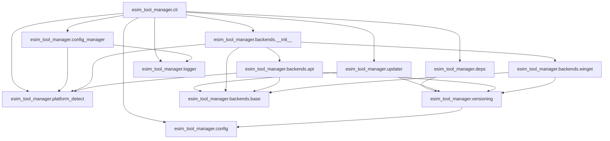
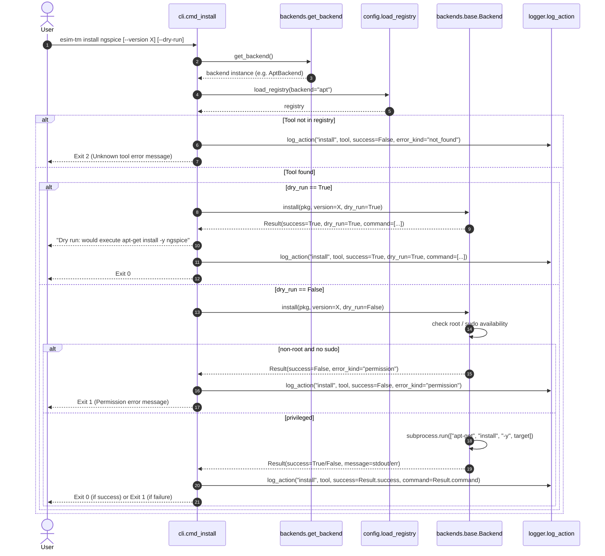
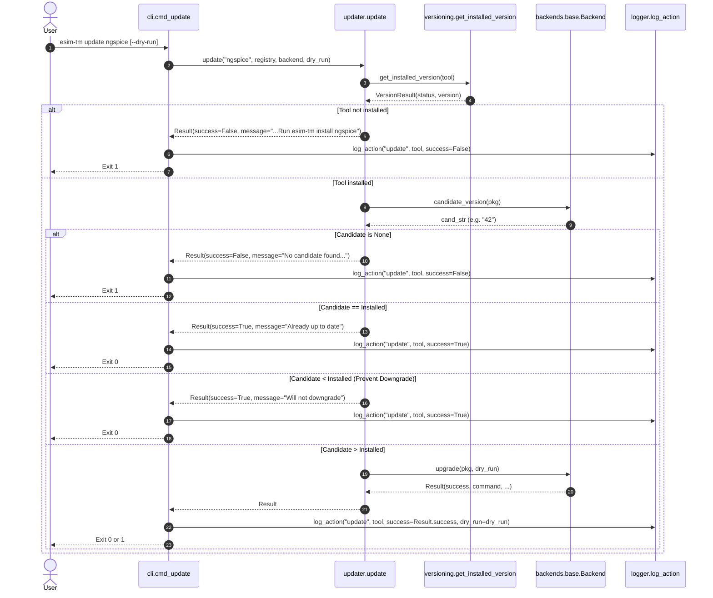
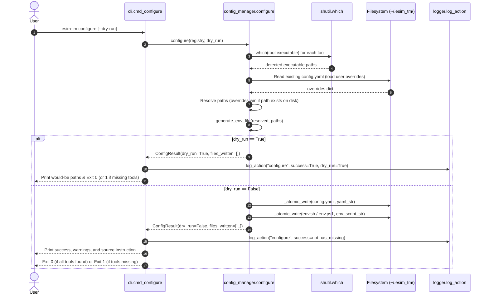

# Automated Tool Manager for eSim — Design & Architecture Document

This document specifies the technical design, architecture, component models, and operational characteristics of `esim-tm` (the Automated Tool Manager for eSim), built for Task 5 of the FOSSEE eSim Semester Long Internship screening submission.

---

## 1. Problem Statement and Goals

### eSim Context & Operational Pain Points
eSim is an open-source EDA (Electronic Design Automation) simulation framework integrating disparate open-source tools:
- **Simulation engines**: `ngspice` (SPICE circuit simulator), `ghdl` (VHDL simulator), `verilator` (Verilog cycle-accurate simulator).
- **Schematic & PCB layout**: `kicad`.
- **Core language runtime**: `python3` (>= 3.10 required for modern eSim releases).
- **Python ecosystem libraries**: `PyQt5` (GUI application shell), `matplotlib` (waveform plotting), `numpy` and `scipy` (numerical computation), and `hdlparse` (HDL component AST extraction).

Historically, setting up eSim requires running complex multi-step installation scripts or manually hunting down individual package dependencies across varied package managers. Common points of failure include:
1. **Version mismatch**: Outdated `ngspice` (e.g., version < 37) or older `kicad` libraries leading to silent simulation or layout failures.
2. **Missing simulation backends**: Users attempting hybrid mixed-signal or digital simulations without `ghdl` or `verilator` present on system PATH.
3. **Python runtime divergence**: eSim invoked from one Python binary while pip packages are installed into another interpreter.
4. **Debian/Ubuntu PEP 668 restrictions**: On modern systems (Debian 12+, Ubuntu 23.04+), running unmanaged `pip install` commands triggers `externally-managed-environment` errors that abort naive setup scripts.
5. **No unified inspection or diagnostic tooling**: Users have no single tool to inspect tool health, verify candidate repository updates, or generate shell environment definitions pointing to valid executables.

### Requirements Met in this Prototype
`esim-tm` satisfies all core and optional criteria of Task 5:
- **Tool Installation Management**: Installs designated system packages (`apt` on Debian/Ubuntu, `winget` on Windows) with explicit version-pinning capability, dry-run simulation mode, and non-interactive frontend flags (`DEBIAN_FRONTEND=noninteractive`).
- **Update and Upgrade System**: Resolves candidate repository versions, compares them against installed versions with PEP 440 semantic parsing, enforces safety guards against accidental package downgrades, and upgrades tools individually or in batch.
- **Configuration Handling**: Automatically searches host PATH for registered tool binaries, reads/preserves user-defined overrides in `~/.esim_tm/config.yaml`, and writes isolated environment export scripts (`~/.esim_tm/env.sh` / `env.ps1`) using atomic file operations.
- **Extras**:
  - *Dependency Checker*: Validates runtime prerequisites (Python >= 3.8, pip functioning, tool binaries, pip packages via `importlib.metadata`) and outputs exact, PEP 668-compliant remedial commands.
  - *CLI*: Provides clean, aligned tabular interfaces via standard `argparse` without external visual layout dependencies.
  - *Action Log*: Maintains structured, newline-delimited JSON (JSONL) audit logs at `~/.esim_tm/actions.log` using rotating file handlers (1 MB limit, 3 backup files).

---

## 2. Architecture Overview

The system is organized into modular subsystems: the CLI presentation layer, configuration and registry validation, platform detection, version extraction and semantic comparison, package manager execution backends, update logic, dependency diagnostics, environment generator, and persistent action logging.

### Component Dependency Flow
The following diagram illustrates actual internal imports across modules, verified via code inspection:



---

## 3. Module Breakdown

### `esim_tool_manager.config`
- **Responsibility**: Loads `tools.yaml`, performs strict schema validation, verifies regex group counts and platform-specific package bindings, and exposes immutable `ToolSpec` dataclasses through a `Registry` object.
- **Key Classes / Functions**: `ToolSpec`, `Registry`, `load_registry(path, backend)`, `ConfigError`.
- **Inputs**: YAML file path (or default `tools.yaml`), active backend name (`"apt"` or `"winget"`).
- **Outputs**: Instantiated, validated `Registry` containing frozen `ToolSpec` instances.
- **Deliberately Does NOT Do**: Does not resolve paths on disk, run version commands, or query network package indices.

### `esim_tool_manager.platform_detect`
- **Responsibility**: Probes the host OS, reads `/etc/os-release` on Linux, verifies backend tool availability via `shutil.which`, and checks for elevated/root privileges.
- **Key Classes / Functions**: `PlatformInfo`, `DistroInfo`, `detect_os()`, `detect_distro()`, `detect_backend()`, `is_privileged()`, `get_platform_info()`, `UnsupportedPlatformError`.
- **Inputs**: Host system properties (`platform.system()`, `shutil.which()`, `/etc/os-release`, `os.geteuid()`).
- **Outputs**: `PlatformInfo` snapshot.
- **Deliberately Does NOT Do**: Does not spawn package managers or install dependencies.

### `esim_tool_manager.versioning`
- **Responsibility**: Executes each tool's `version_cmd` (without `shell=True`), extracts the raw version substring using the tool's configured regex, cleans packaging/distro metadata via `normalize_version()`, parses semver/PEP 440 with `packaging.version.Version`, and checks minimum thresholds via `packaging.specifiers.SpecifierSet`.
- **Key Classes / Functions**: `VersionResult`, `get_installed_version(tool)`, `normalize_version(raw)`, `compare(installed, min_version)`.
- **Inputs**: `ToolSpec` instance.
- **Outputs**: `VersionResult` (containing status `"installed" | "not_installed" | "unparsable" | "timeout"`, `raw_output`, and parsed `Version | None`).
- **Deliberately Does NOT Do**: Does not prompt users or attempt installation if a tool is not installed.

### `esim_tool_manager.backends.base`
- **Responsibility**: Defines the abstract base contract for package managers, structured execution result containers, error classification logic, and safe subprocess invocation.
- **Key Classes / Functions**: `Backend` (ABC), `Result` dataclass, `_run(cmd, dry_run, timeout, env)`, `classify_error(stderr)`.
- **Inputs**: Command string lists, environment mappings, dry-run flags.
- **Outputs**: Structured `Result` instances.
- **Deliberately Does NOT Do**: Contains no platform-specific package manager logic.

### `esim_tool_manager.backends.apt`
- **Responsibility**: Implements `apt-get` and `apt-cache` integration for Debian/Ubuntu environments. Handles `sudo` prepending for non-root users, non-interactive flags, candidate version parsing from `apt-cache policy`, and pinned package installs.
- **Key Classes / Functions**: `AptBackend`.
- **Inputs**: Package names, versions, dry-run flags.
- **Outputs**: `Result` instances, candidate version strings.
- **Deliberately Does NOT Do**: Does not run `apt-get update` automatically during install or upgrade; updates are explicitly separated into `refresh_index()`.

### `esim_tool_manager.backends.winget`
- **Responsibility**: Provides a thin Windows Package Manager wrapper for Windows environments. (Covered by mocked tests only; untested on real Windows hardware).
- **Key Classes / Functions**: `WingetBackend`.
- **Inputs**: Package IDs, versions, dry-run flags.
- **Outputs**: `Result` instances, candidate version strings.
- **Deliberately Does NOT Do**: Does not manage Windows registry entries, environment variables, or GUI installers directly.

### `esim_tool_manager.backends`
- **Responsibility**: Exposes the `BACKENDS` registry dictionary and `get_backend()` factory function.
- **Key Classes / Functions**: `get_backend(name=None)`.
- **Inputs**: Optional backend identifier string.
- **Outputs**: Instantiated `Backend` subclass (`AptBackend` or `WingetBackend`).
- **Deliberately Does NOT Do**: Does not perform dynamic discovery or arbitrary plugin loading.

### `esim_tool_manager.updater`
- **Responsibility**: Performs update status analysis across all registry tools and executes single or batch upgrades.
- **Key Classes / Functions**: `UpdateStatus` (Enum), `UpdateRow` dataclass, `check_updates(registry, backend)`, `update(tool_name, registry, backend, dry_run)`, `update_all(registry, backend, dry_run)`.
- **Inputs**: `Registry`, active `Backend`, `dry_run` flag.
- **Outputs**: `list[UpdateRow]` status report, `Result` instances.
- **Deliberately Does NOT Do**: Never installs uninstalled tools during an update command; never downgrades an existing tool if the repository candidate is older; does not refresh the repository index automatically.

### `esim_tool_manager.deps`
- **Responsibility**: Assesses environment prerequisites: Python interpreter version, pip CLI functionality, system tool availability/versions, and pip package distributions (evaluated using `importlib.metadata.version` without invoking pip subprocesses).
- **Key Classes / Functions**: `DepStatus` (Enum), `DepItem` dataclass, `DepReport` dataclass, `check_dependencies(registry, backend)`.
- **Inputs**: `Registry`, active `Backend`.
- **Outputs**: `DepReport` with status, detected/required versions, and recommended non-destructive remediation command strings.
- **Deliberately Does NOT Do**: Never executes remediation commands; never runs `pip install` subprocesses.

### `esim_tool_manager.config_manager`
- **Responsibility**: Resolves installed tool executable paths using `shutil.which`, manages `~/.esim_tm/config.yaml` with persistent user overrides, and generates isolated shell export scripts (`~/.esim_tm/env.sh` or `env.ps1`).
- **Key Classes / Functions**: `ConfigResult`, `detect_tool_paths(registry)`, `generate_env_file(resolved_paths)`, `configure(registry, dry_run)`, `show_config()`.
- **Inputs**: `Registry`, `dry_run` flag, disk state.
- **Outputs**: `ConfigResult`, written `config.yaml` and `env.sh` / `env.ps1`.
- **Deliberately Does NOT Do**: Never modifies shell profile files (`~/.bashrc`, `~/.profile`, etc.); never modifies files outside the designated `ESIM_TM_HOME` directory.

### `esim_tool_manager.logger`
- **Responsibility**: Manages the persistent, rotating JSONL audit log file (`actions.log`) with strict non-failing exception safety.
- **Key Classes / Functions**: `log_action(action, tool, success, dry_run, command, message, error_kind)`, `read_log(tail)`, `get_log_dir()`, `get_log_file()`.
- **Inputs**: Action metadata parameters.
- **Outputs**: Append-only records to `actions.log`, list of JSON dictionary records from `read_log()`.
- **Deliberately Does NOT Do**: Never throws unhandled exceptions that could crash calling commands if the disk or log file is unwritable.

### `esim_tool_manager.cli`
- **Responsibility**: Command-line presentation and user dispatch layer built entirely on standard library `argparse`.
- **Key Classes / Functions**: `main(argv)`, command handlers (`cmd_list`, `cmd_check`, `cmd_install`, `cmd_update`, `cmd_refresh`, `cmd_deps`, `cmd_log`, `cmd_configure`).
- **Inputs**: Command-line arguments.
- **Outputs**: Aligned terminal text tables, exit codes (0, 1, 2).
- **Deliberately Does NOT Do**: Contains zero business logic, package resolution, or version comparison algorithms.

---

## 4. `tools.yaml` Schema

The canonical tool registry resides at `tools.yaml` in the project root. Every entry in the top-level `tools` list conforms to the schema below:

### Field Definitions

| Field | Type | Required | Description |
|---|---|---|---|
| `name` | `string` | **Yes** | Canonical unique tool identifier (e.g., `ngspice`, `PyQt5`). |
| `display_name` | `string` | No | Human-readable label (defaults to `name` if omitted). |
| `kind` | `string` | **Yes** | Must be strictly `"system"` or `"pip"`. |
| `executable` | `string` | No | Binary executable filename searched on PATH via `shutil.which` (empty for non-CLI pip libraries). |
| `version_cmd` | `string` | **Yes** | Command executed to extract version text (run via `shlex.split`, `shell=False`). |
| `version_regex`| `string` | **Yes** | Python regular expression containing **exactly one capture group** yielding the version string. |
| `min_version` | `string` | No | Minimum version specifier floor (e.g., `"37"`, `"7.0.0"`). Evaluated using `>=`. |
| `latest_stable`| `string` | No | Pinned target version (or empty string for unpinned latest). |
| `depends_on` | `list[str]`| No | List of prerequisite tool `name` references. Must refer to valid tools defined in the same registry. |
| `pkg_name_apt` | `string` | Conditional | Package name for `apt-get`. Must be non-empty if `kind == "system"` and running on an apt host. |
| `pkg_name_winget` | `string` | Conditional | Package ID for `winget`. Must be non-empty if `kind == "system"` and running on a winget host. |
| `pip_package` | `string` | Conditional | PyPI package distribution name. Must be non-empty if `kind == "pip"`. |
| `install_notes`| `string` | No | Explanatory notes displayed to user upon installation. |

### Concrete Schema Examples

```yaml
tools:
  - name: ngspice
    display_name: "Ngspice Circuit Simulator"
    kind: system
    executable: ngspice
    version_cmd: "ngspice --version"
    version_regex: 'ngspice-(\d+)'
    min_version: "37"
    latest_stable: ""
    depends_on: []
    pkg_name_apt: ngspice
    pkg_name_winget: "ngspice.ngspice"
    pip_package: ""
    install_notes: "Restart eSim after installing ngspice."

  - name: PyQt5
    display_name: "PyQt5 (Qt5 bindings for Python)"
    kind: pip
    executable: ""
    version_cmd: "python3 -c \"import PyQt5; print(PyQt5.QtCore.PYQT_VERSION_STR)\""
    version_regex: '(\d+\.\d+\.\d+)'
    min_version: "5.15.0"
    latest_stable: ""
    depends_on: [python3]
    pkg_name_apt: python3-pyqt5
    pkg_name_winget: ""
    pip_package: PyQt5
    install_notes: ""
```

### Validation Rules and Failure Modes
`esim_tool_manager.config.load_registry` enforces validation on load:
1. **Mapping and non-empty list**: Top-level structure must be a mapping with a non-empty `tools` list (`ConfigError: tools.yaml must contain a non-empty 'tools' list`).
2. **Missing required fields**: Missing `name`, `kind`, `version_cmd`, or `version_regex` raises `ConfigError: <ctx>: missing required field '<field>'`.
3. **Invalid kind**: Any value other than `"system"` or `"pip"` raises `ConfigError: <ctx>: 'kind' must be one of ['pip', 'system']`.
4. **Regular expression syntax & groups**: If `version_regex` cannot compile, it raises `ConfigError: <ctx>: 'version_regex' is not a valid Python regex`. If `compiled.groups != 1`, it raises `ConfigError: <ctx>: 'version_regex' must contain exactly 1 capture group`.
5. **Backend package presence**: If `kind == "system"` but the package name for the active platform backend (`pkg_name_apt` or `pkg_name_winget`) is empty, it raises `ConfigError: <ctx>: kind='system' but 'pkg_name_<backend>' is empty`.
6. **Pip package presence**: If `kind == "pip"` and `pip_package` is empty, it raises `ConfigError: <ctx>: kind='pip' but 'pip_package' is empty`.
7. **Dangling dependencies**: If any entry in `depends_on` does not correspond to a defined tool name, validation fails with `ConfigError: tool '<tool>': depends_on includes '<dep>' which is not defined in tools.yaml`.

---

## 5. Sequence Diagrams

### 1. `esim-tm install <tool>`



### 2. `esim-tm update <tool>`



### 3. `esim-tm configure`



---

## 6. Version Detection and Comparison

### Execution and Capture
When querying an installed tool version via `esim_tool_manager.versioning.get_installed_version(tool)`:
1. `tool.version_cmd` is tokenized using `shlex.split` into an argument list.
2. `subprocess.run(cmd, capture_output=True, text=True, timeout=10)` executes without `shell=True`.
3. If the executable is missing on PATH, `FileNotFoundError` is caught and translated to `VersionResult(status="not_installed", ...)`.
4. If execution exceeds 10 seconds, `subprocess.TimeoutExpired` is caught and translated to `VersionResult(status="timeout", ...)`.
5. Combined output `stdout + "\n" + stderr` is matched against the pre-compiled regex `tool.compiled_version_regex()`. (Both streams are searched because tools like `ghdl` write banner details to `stderr`).
6. The regex capture group is normalized with `normalize_version()`, then passed to `packaging.version.Version(normalised)`. If parsing fails, `packaging.version.InvalidVersion` is caught and mapped to `VersionResult(status="unparsable", ...)`.
7. Comparison against `min_version` uses `packaging.specifiers.SpecifierSet(f">={min_version}")`.

### Normalization Logic & Verified Test Cases
`normalize_version(raw)` cleans non-semver suffixes (e.g., Debian packaging labels, Git dev hashes):
1. Discards Debian local build suffixes by splitting on `+` and keeping the prefix.
2. Extracts the leading numeric segment (`\d+(?:\.\d+)*`), stripping suffixes like `-1ubuntu1`, `-dev`, or `-rc1`.

The table below reflects real test cases verified in `tests/test_versioning.py`:

| Input String (`raw`) | Normalized Output | Parsed `packaging.version.Version` |
|---|---|---|
| `"3.0.0"` | `"3.0.0"` | `Version("3.0.0")` |
| `"42"` | `"42"` | `Version("42")` |
| `"5.020"` | `"5.020"` | `Version("5.020")` |
| `"8.0.2-1ubuntu1"` | `"8.0.2"` | `Version("8.0.2")` |
| `"42+ds-1"` | `"42"` | `Version("42")` |
| `"3.0.0-dev"` | `"3.0.0"` | `Version("3.0.0")` |
| `"5.1.0-rc1"` | `"5.1.0"` | `Version("5.1.0")` |
| `"5.0"` | `"5.0"` | `Version("5.0")` |
| `"unknown"` | `"unknown"` | *InvalidVersion -> status="unparsable"* |

---

## 7. Error Handling and Security

### Subprocess Safety & Injection Prevention
- **No `shell=True` anywhere**: Every command executed across `backends/base.py`, `backends/apt.py`, `backends/winget.py`, `versioning.py`, and `deps.py` is invoked as an explicit argument vector (`list[str]`).
- **Path quoting in generated scripts**: In `config_manager.generate_env_file()`, all directory and variable paths are escaped via `shlex.quote()` for bash, preventing shell command injection even if paths contain spaces, quotes, or subshell expansion tokens (e.g. `$(rm -rf /)`).

### Privilege Handling
- `AptBackend._prepare_cmd()` invokes `platform_detect.geteuid()`. If UID != 0 (non-root), it verifies if `sudo` exists on PATH via `shutil.which("sudo")`.
- If non-root and `sudo` is absent, the backend aborts execution immediately and returns `Result(success=False, error_kind="permission")` without running a command.

### `ErrorKind` Classification
Subprocess failures are parsed across combined standard streams by `classify_error(stderr)` in `backends/base.py`:
- `"permission"`: `"permission denied"`, `"are you root"`, `"need to be root"`, `"requires admin"`, `"access is denied"`, `"failed to lock"`, `"could not open lock file"`.
- `"network"`: `"could not resolve"`, `"failed to connect"`, `"connection timed out"`, `"network is unreachable"`, `"temporary failure in name resolution"`, `"failed to fetch"`.
- `"not_found"`: `"unable to locate package"`, `"no package found"`, `"no applicable update found"`, `"cannot find"`.
- `"version_unavailable"`: `"version ... was not found"`, `"no matching version"`, `"requested version not found"`.
- `"unknown"`: Default for uncategorized errors.

### Exit Codes
The CLI conforms to predictable exit code conventions:
- **`0`**: Command succeeded completely (or all tools are up-to-date in `esim-tm check`).
- **`1`**: Action failed (e.g. package install failed, update failed, missing dependencies found, or tools missing in `configure`).
- **`2`**: Configuration or usage error (unknown tool name, missing arguments, invalid `tools.yaml`, or `UnsupportedPlatformError`).

### Atomic Writes & Boundary Isolation
- Configuration writes use `_atomic_write(path, content)` in `config_manager.py`: writes to a hidden temporary file `.tmp_*` inside the target directory, followed by `os.replace`. If interrupted, destination files remain uncorrupted and temporary files are cleaned up.
- **Home directory containment**: All generated files (`config.yaml`, `env.sh`, `env.ps1`, `actions.log`) reside strictly inside `~/.esim_tm/` (or the directory pointed to by `ESIM_TM_HOME`). Shell rc files (`~/.bashrc`, `~/.zshrc`) are never modified.

### Fail-Safe Logging
- `log_action()` in `esim_tool_manager.logger` encapsulates all directory creation, serialization, and disk writing inside blanket exception guards. If the target disk is full, read-only, or permissions fail, a warning is printed to `sys.stderr` and execution proceeds without crashing.

---

## 8. Design Decisions and Alternatives Considered

| Decision | Alternative Considered | Trade-off & Rationale |
|---|---|---|
| **Static backend dictionary** (`BACKENDS = {"apt": AptBackend, "winget": WingetBackend}`) | Dynamic entry points or runtime plugin discovery (`importlib.metadata.entry_points`). | Dynamic discovery adds plugin resolution overhead, debugging complexity, and security surface for a fixed set of package managers. A simple dictionary lookup in `backends/__init__.py` is explicit, testable, and robust. |
| **`packaging` library for semver & specifiers** | Standard library `distutils.version` or custom semver regex comparison. | `distutils` was deprecated in Python 3.10 and completely removed in Python 3.12. Custom semver regexes fail on complex real-world variants (e.g., `42`, `5.020`, `8.0.2-1ubuntu1`). `packaging.version.Version` and `SpecifierSet` conform to PEP 440 standards. |
| **Newline-delimited JSON (`actions.log`)** | Unstructured plain text logs (`.log`) or relational database (SQLite). | JSONL provides structured, machine-parsable event records that can be streamed, filtered with `jq`, and tail-read efficiently, while remaining human-readable when formatted by `esim-tm log`. |
| **Dropped generic tarball backend** | Downloading and extracting arbitrary tarballs / raw binaries from GitHub or SourceForge. | Pulling arbitrary binaries into user directories introduces significant security risks, requires maintaining brittle SHA-256 hash catalogs across multiple architectures, and cannot handle dynamic library (`.so`) dependencies cleanly. Dropping it leaves package management to native system managers. |
| **Print `source ~/.esim_tm/env.sh` instead of auto-modifying `.bashrc`** | Appending `source ~/.esim_tm/env.sh` automatically to `~/.bashrc` or `~/.profile`. | Silently mutating user shell startup scripts can break non-interactive subshells, causes test pollution, and violates system boundary etiquette. Providing the exact command gives users full control. |
| **PEP 668 compliant dependency suggestions** | Plain `pip install <package>` suggestions for missing Python libraries. | On modern Debian/Ubuntu distributions, unadorned `pip install` fails with `externally-managed-environment`. `esim-tm deps` prioritizes the distro apt package (`python3-pyqt5`, `python3-numpy`), falling back to an explicit isolated `.venv` recipe only when no system package exists (e.g. `hdlparse`). |

---

## 9. Testing Strategy

### Complete Subprocess and Platform Isolation
The entire test suite is completely sandboxed:
- **Zero live package installations**: Every invocation of `subprocess.run` across package managers (`apt-get`, `winget`, `pip`) and tool versions (`ngspice`, `kicad`) is mocked using `unittest.mock.patch`.
- **Zero filesystem pollution**: All tests mutating configuration or log files isolate target paths to `pytest`'s temporary fixture `tmp_path` using `monkeypatch.setenv("ESIM_TM_HOME", ...)`.
- **Cross-platform mocking**: POSIX privilege calls (`geteuid`) and Windows administrator checks (`ctypes.windll.shell32.IsUserAnAdmin`) are mocked to allow full suite execution on any operating system runner.

### Test Coverage Breakdown (165 Total Tests)
As verified by running `pytest tests/ -v`:

```
collected 165 items:
  - tests/test_config.py:           26 passed (schema validation, regex groups, dependencies, immutability)
  - tests/test_platform_detect.py:  30 passed (OS detection, distro parsing, backend selection, privilege detection)
  - tests/test_versioning.py:       32 passed (normalization variants, timeout, missing binary, stderr versions, comparisons)
  - tests/test_backends_apt.py:     14 passed (root/sudo prepending, dry-run, pinned installs, candidate parsing, error classification)
  - tests/test_backends_winget.py:   7 passed (install, upgrade, pinned version, candidate show)
  - tests/test_backends_factory.py:  6 passed (registry lookup, automatic detection, unsupported platform raises)
  - tests/test_updater.py:          15 passed (update checks, status priorities, downgrade prevention, batch update continuation)
  - tests/test_deps.py:              9 passed (Python version floor, pip check, missing tools, PEP 668 remediation recipes)
  - tests/test_logger.py:            5 passed (JSONL writing, rotating file handlers, unwritable dir safety, tail filtering)
  - tests/test_cli.py:              10 passed (exit codes 0/1/2, table alignment, dry-run propagation, traceback suppression)
  - tests/test_config_manager.py:   11 passed (override precedence, quoting, PATH deduplication, atomic writes, corruption handling)

Total: 165 passed in 4.68s
```

---

## 10. Limitations and Known Observations

1. **Windows / WinGet Backend Status**:
   - The `winget` backend (`WingetBackend`) is a thin wrapper validated purely through mocked unit tests. It has **not been tested on real Windows hardware**.
2. **Platform Support Scope**:
   - Only Debian/Ubuntu Linux (`apt`) and Windows (`winget`) are supported. Other distributions using `dnf` (Fedora/RHEL), `pacman` (Arch), or macOS `brew` currently raise `UnsupportedPlatformError`.
3. **Unresolved Registry Entries (`# VERIFY`)**:
   - `kicad` on Debian/Ubuntu: In `tools.yaml`, `pkg_name_apt: kicad` notes that older Ubuntu releases (< 23.04) require adding a PPA (`ppa:kicad/kicad-7.0-releases`) to obtain KiCad 7+.
   - `winget` IDs: Package identifiers such as `Python.Python.3.10`, `ngspice.ngspice`, and `verilator.verilator` need verification against current Microsoft Community Repository manifests.
   - `hdlparse`: There is currently no official standard Debian `apt` package for `hdlparse`; it must be installed into a virtual environment.
4. **Environment Generation on Windows**:
   - When run on Windows, `config_manager.generate_env_file` generates `env.ps1` with PowerShell syntax. While functional, it is untested in complex mixed-shell corporate Windows environments.

---

## 11. Code Observations Identified During Architectural Review

In accordance with the code freeze, the following minor behavioral nuances were identified during architectural verification and documented without altering the frozen code:

1. **`esim-tm configure` exit code under `--dry-run`**:
   - In `cli.py` (`cmd_configure`), the function returns `1 if res.warnings else 0`. If tools are missing on the system when `--dry-run` is invoked, it exits with status `1` to signal missing components, rather than `0`.
2. **`check_updates` candidate query for pip tools**:
   - In `updater.py` line 77, `cand_str = backend.candidate_version(pkg_name)` passes `tool.pkg_name_for(backend.name)`. For pip tools with no corresponding system package mapping on the current platform, `pkg_name` evaluates to empty, resulting in `status=UNKNOWN_CANDIDATE`. (Pip package health and compatibility are evaluated and reported via `esim-tm deps` using `importlib.metadata`).
3. **PowerShell single-quote escaping in `config_manager.py`**:
   - In `config_manager.py`, single-quote characters in path strings are escaped via `.replace("'", "''")`. While valid for standard PowerShell literals, paths containing trailing backslashes immediately adjacent to quotes should use verbatim literal syntax (`@'...'@`) in future revisions if Windows support is extended beyond the current prototype.

---

## Consistency Check & Verification Matrix

Every diagram, table, and code citation in this document has been cross-verified against the physical source repository:

| Section / Artifact | Source Files Verified Against | Verification Command / Method |
|---|---|---|
| **Section 2 Flowchart** | `esim_tool_manager/*.py`, `esim_tool_manager/backends/*.py` | `grep -rn "^from\|^import" esim_tool_manager/` |
| **Section 3 Module Breakdown** | All 11 package Python files | Direct inspection of classes, functions, and return types |
| **Section 4 tools.yaml Schema** | `tools.yaml`, `esim_tool_manager/config.py` | Line-by-line verification against `ToolSpec` and `_parse_spec` |
| **Section 5 Sequence Diagrams** | `cli.py`, `backends/base.py`, `backends/apt.py`, `updater.py`, `config_manager.py` | Step-by-step trace of call order and branching in handlers |
| **Section 6 Normalization Table** | `esim_tool_manager/versioning.py`, `tests/test_versioning.py` | Exact string inputs and assertions extracted from unit tests |
| **Section 7 Error Handling** | `backends/base.py`, `cli.py`, `config_manager.py` | Inspection of `classify_error`, `_atomic_write`, and `shlex.quote` |
| **Section 8 Design Decisions** | Git history, design approvals, and current implementation | Verified against constraints established in Steps 1–6 |
| **Section 9 Testing Strategy** | All 11 test modules under `tests/` | Verified via `python -m pytest tests/ -v` (165 passed) |
| **Section 10 Limitations** | `tools.yaml`, `platform_detect.py`, `backends/winget.py` | Verified `# VERIFY` comments and docstring notices |
